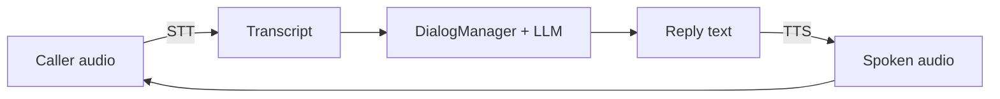

<p align="center"></p>

<h1 align="center">AI Voice Agent</h1>

<p align="center">Build production-grade AI voice agents — speech-to-text → LLM dialog → text-to-speech — that run and test fully offline.</p>

<p align="center"><em>Built and maintained by <a href="https://viprasol.com">Viprasol Tech</a> — Fintech Experts. Full-Stack Builders.</em></p>

<p align="center">
  <a href="https://github.com/Viprasol-Tech/ai-voice-agent/actions/workflows/ci.yml"></a>
  <a href="LICENSE"></a>
  
  <a href="https://github.com/astral-sh/ruff"></a>
  <a href="https://t.me/viprasol_help"></a>
  <a href="https://github.com/Viprasol-Tech/ai-voice-agent/stargazers"></a>
</p>

---

A small, dependency-light Python toolkit for building **AI voice agents** — phone bots and voice assistants. It wires three pluggable stages into one pipeline:

```
inbound audio  ──STT──▶  text  ──LLM (dialog manager)──▶  reply  ──TTS──▶  spoken audio
```

Every stage is an abstract base class with a **deterministic offline fake**, so the entire stack runs, demos, and tests **without any network access or API keys**. When you're ready for production, swap in the lazy-loaded ElevenLabs (TTS) and Twilio (telephony) adapters.

## ✨ Features

- 🎙️ **Full STT → LLM → TTS pipeline** wired by a single `VoiceAgent` class.
- 🧩 **Pluggable providers** — clean `STT` / `TTS` / `LLM` abstract base classes.
- 🧪 **Deterministic offline fakes** — run and test with zero network or keys.
- 🔁 **Lossless fake round-trip** — `FakeTTS` → `FakeSTT` recovers text exactly.
- 💬 **Dialog manager** with turn-taking and conversation state.
- ☎️ **Twilio telephony webhook** (FastAPI) returning valid TwiML — lazy import.
- 🗣️ **ElevenLabs TTS adapter** for natural speech — lazy import.
- ⌨️ **CLI** for a text-simulated conversation (`python -m ai_voice_agent`).
- 🐍 **Typed end to end** — ships `py.typed`, passes `mypy --strict`.
- 🧹 **Modern tooling** — ruff, mypy strict, pytest, multi-OS CI, Docker.
- 📦 **Single-source packaging** via hatchling + `pyproject.toml`.
- 🔌 **No required dependencies** — adapters live behind optional extras.

## 🚀 Quickstart

```bash
pip install ai-voice-agent

# Optional adapters:
pip install "ai-voice-agent[elevenlabs]"   # real TTS
pip install "ai-voice-agent[twilio]"       # telephony webhook
```

Run a text-simulated conversation (offline):

```bash
python -m ai_voice_agent
# or one-shot:
python -m ai_voice_agent --say "Hello!" --say "What is your name?"
```

## 🏗️ Architecture

| Component | Role | Offline fake | Real adapter |
| --- | --- | --- | --- |
| `STT` | audio → text | `FakeSTT` | (bring your own) |
| `LLM` | messages → reply | `FakeLLM` | (bring your own) |
| `TTS` | text → audio | `FakeTTS` | `ElevenLabsTTS` |
| `DialogManager` | turn-taking + state | — | — |
| `VoiceAgent` | end-to-end pipeline | — | — |
| Telephony | Twilio webhook → TwiML | — | `create_twilio_app` (FastAPI) |



## 🧑‍💻 Usage

```python
from ai_voice_agent import VoiceAgent, FakeSTT, FakeLLM, FakeTTS

agent = VoiceAgent(stt=FakeSTT(), llm=FakeLLM(name="Vira"), tts=FakeTTS())

reply = agent.handle_text("What is your name?")
print(reply.reply_text)        # -> "I'm Vira, an AI voice agent by Viprasol Tech."
print(len(reply.audio), "bytes of synthesized audio")
```

Telephony (Twilio + FastAPI):

```python
from ai_voice_agent import VoiceAgent, FakeSTT, FakeLLM, FakeTTS
from ai_voice_agent.telephony import create_twilio_app

agent = VoiceAgent(stt=FakeSTT(), llm=FakeLLM(), tts=FakeTTS())
app = create_twilio_app(agent)   # point your Twilio number's webhook at /twilio/voice
```

See [`examples/demo_conversation.py`](examples/demo_conversation.py) for a full runnable demo.

## 🗺️ Roadmap

- [x] STT/TTS/LLM ABCs with offline fakes
- [x] Dialog manager with turn-taking
- [x] Twilio webhook + ElevenLabs adapter
- [ ] Streaming / partial-transcript support
- [ ] Whisper and OpenAI provider adapters
- [ ] Barge-in and interruption handling
- [ ] Conversation analytics and transcripts export

## 🤝 Contributing

Contributions are welcome! Please read [CONTRIBUTING.md](CONTRIBUTING.md) and our [Code of Conduct](CODE_OF_CONDUCT.md) before opening a pull request.

## 📬 Contact — Viprasol Tech Private Limited

- 🌐 Website: [viprasol.com](https://viprasol.com)
- ✉️ Email: [support@viprasol.com](mailto:support@viprasol.com)
- 💬 Telegram: [t.me/viprasol_help](https://t.me/viprasol_help) · 📱 WhatsApp: +91 96336 52112
- 🐙 GitHub: [@Viprasol-Tech](https://github.com/Viprasol-Tech) · 💼 [LinkedIn](https://www.linkedin.com/in/viprasol/) · 𝕏 [@viprasol](https://twitter.com/viprasol)

> *Viprasol Tech — fintech software, algorithmic trading systems, MT4/MT5 bots, AI voice agents, and B2B SaaS. Need a custom build? [Get in touch](mailto:support@viprasol.com).*

## 📄 License

Released under the [MIT License](LICENSE) — © 2025 Viprasol Tech Private Limited.
